# Google API tokens: what they are and how to create them

The app needs permission to read your Google Sheets through the **Google Sheets API**. Google calls these credentials keys and tokens. There are three kinds, and this app uses the first two:

| Token | What it is | How you get it | In this app |
|---|---|---|---|
| **API key** | A string like `AIza…` that identifies your Google Cloud project (not a person). | You create it in Google Cloud → Credentials ([Option B](#option-b-api-key)). | Fallback. Reads sheets shared as "Anyone with the link can view". Can't list your files. |
| **OAuth tokens** (access token + refresh token) | Proof that a Google user allowed the app to read their sheets. The access token lasts about an hour; the refresh token gets new ones. | You create an **OAuth client** (client ID + secret) in Google Cloud ([Option A](#option-a-oauth-client)), then click **Connect Google account** in the app and allow access. Google then sends the tokens to the app. | Default. Reads your private sheets and lists them, without sharing anything. The app stores the tokens encrypted and renews the access token by itself. |
| Service account key (JSON) | A "robot" Google account with its own key file. Every sheet must be shared with its email. | Google Cloud → Service accounts. | Not used, on purpose: sharing every sheet with a robot email is the step this app avoids (see [DECISIONS.md §7](DECISIONS.md)). |

So "creating the Google API tokens" means: **create the OAuth client and connect** (Option A), and/or **create an API key** (Option B). Both take a few minutes; the steps are below.

## Overview

Sheets Sync connects to Google with your **own** credentials. There are two options, and you can use both:

| | **Option A: OAuth (recommended)** | **Option B: API key (fallback)** |
|---|---|---|
| Reads | **private** sheets your Google account can open | only sheets shared as **"Anyone with the link can view"** |
| Lists your spreadsheets ("Fetch from Google") | yes | no (add sheets by URL) |
| Time to set up | about 10 minutes | about 2 minutes |

With both set, OAuth is used first. The API key is used automatically when OAuth isn't connected, has expired, or can't open a file. The sync history shows which credential was used, and an alert tells you when the fallback is in use.

**Read-only.** The app never writes to your sheets, so it only asks Google for read access.

**Why can't an API key read private sheets?** An API key identifies a Google Cloud *project*, not a person. To open a private sheet, Google needs to know *who* is asking, and OAuth provides that. With OAuth, the app acts as your account, so **no sheet has to be shared with any email**.

**Where the values go:** paste them into **Settings → Google connection** in the admin panel, or run `php artisan google:configure`. They are stored **encrypted in the database** with the app's `APP_KEY` and are never written to `.env`. After saving, the screen only shows a masked hint, and changing a value asks for your password again.

> Google renames menus in the Cloud Console from time to time. If a label below doesn't match exactly, look for the closest one.

---

## Step 1: Create a project and enable the APIs (both options)

1. Open <https://console.cloud.google.com> and sign in. Click the project picker at the top ("Select a project"), then **New project**.

2. Name the project (e.g. `sheets-sync`), leave **No organization**, and click **Create**.

   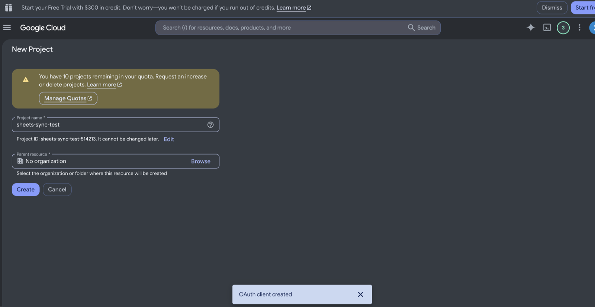

3. Make sure the new project is selected at the top, then open **APIs & Services**.

   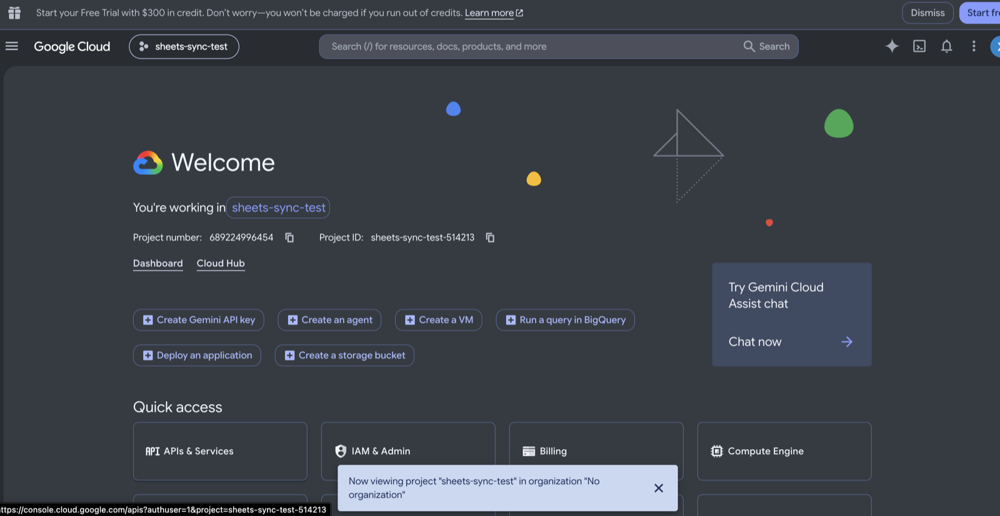

4. Go to **Library**.

   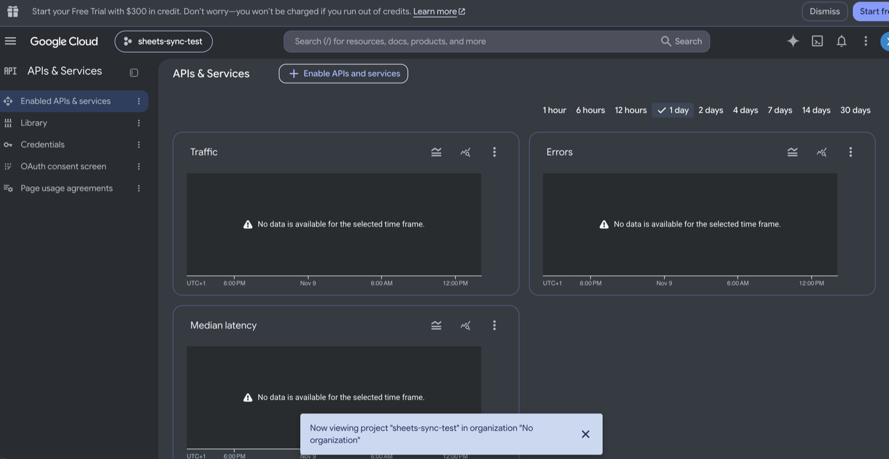

   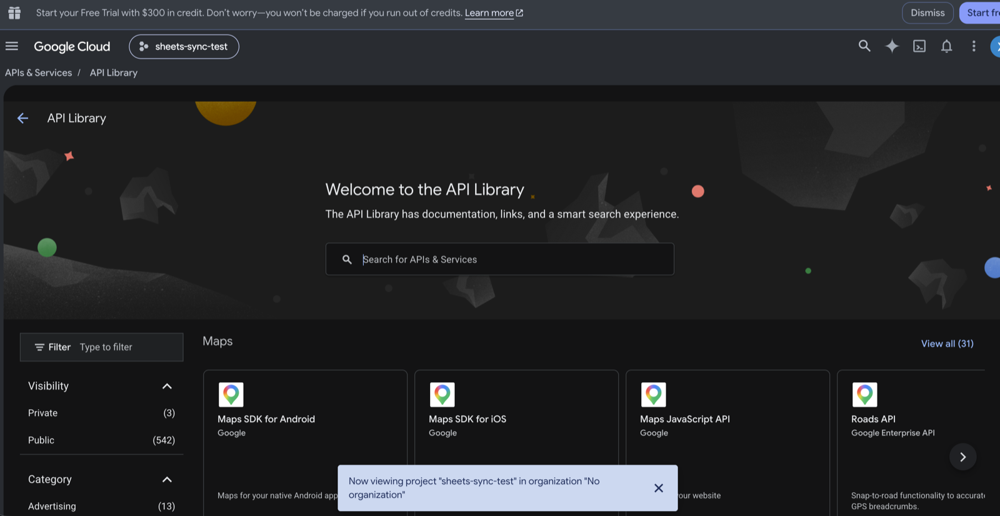

5. Search for **Google Drive API** and click **Enable** (only needed for OAuth, so "Fetch from Google" can list your spreadsheets).

   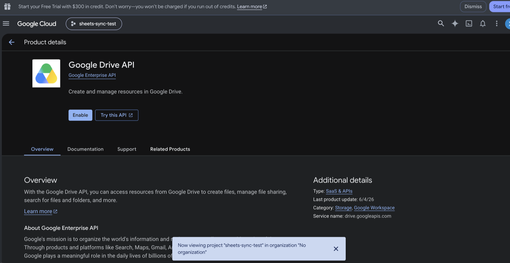

6. Search for **Google Sheets API** and click **Enable** (needed for both options).

   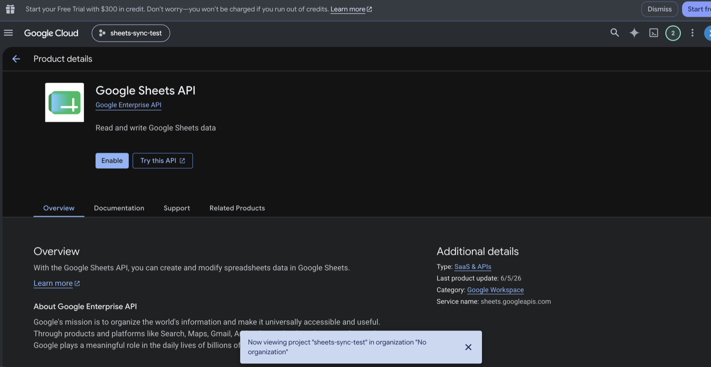

   The status now shows **Enabled**.

## Option A: OAuth client

### A1. Consent screen

1. Go to **Google Auth Platform** (older consoles: **APIs & Services → OAuth consent screen**) and click **Get started**.

   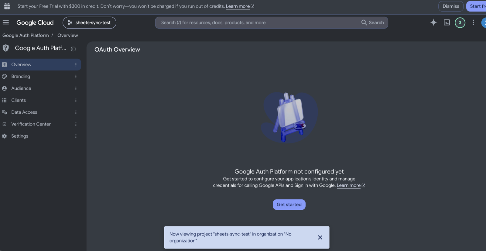

2. **App information:** app name (e.g. `Sheets Sync`) and your email as the user support email. Click **Next**.

   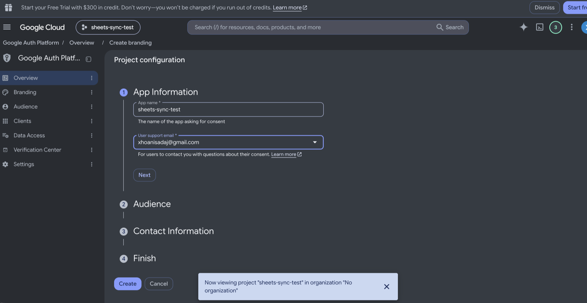

3. **Audience:** choose **External** (or **Internal** if you use Google Workspace and only need your organization). Click **Next**.

   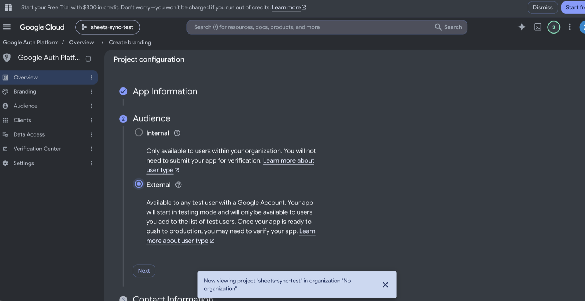

4. **Contact information:** your email. Click **Next**.

   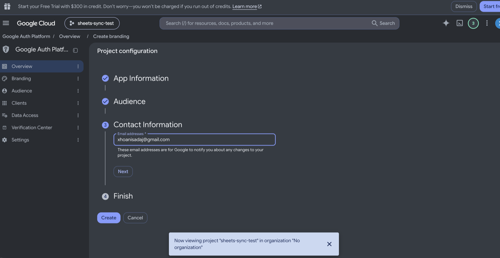

5. **Finish:** tick **I agree to the Google API Services: User Data Policy**, click **Continue**, then **Create**.

   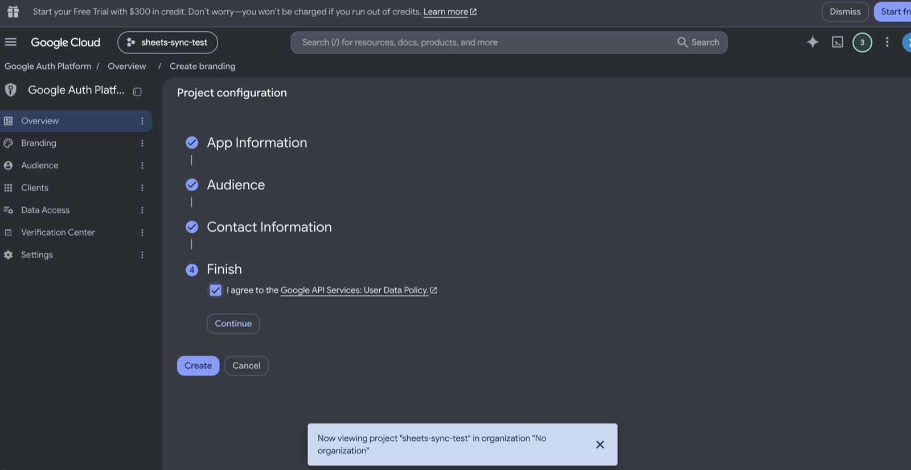

6. Go to **Audience**. Under **Test users**, click **Add users**.

   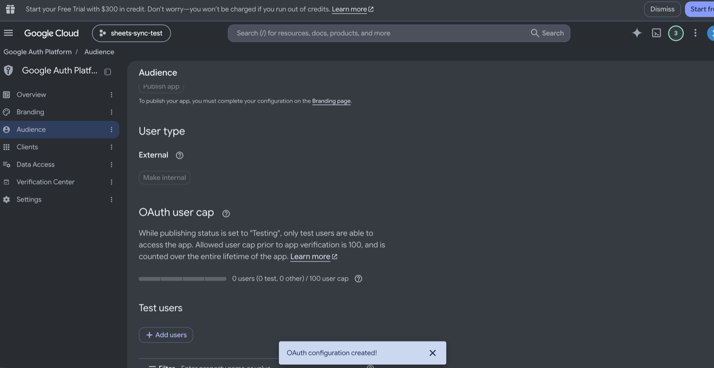

7. Add the Google account(s) that will connect (your own email) and click **Save**. While the app is in *Testing*, only test users can sign in; others get "Access blocked".

   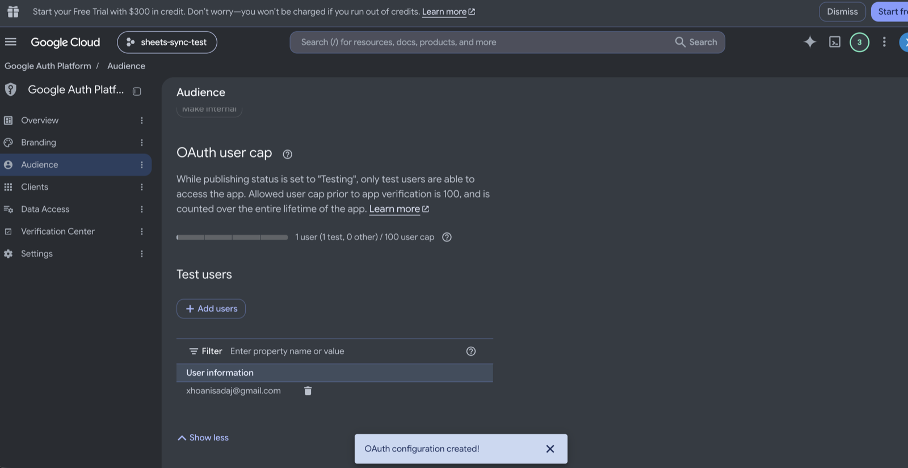

8. Optional: **Data access → Add or remove scopes** makes the consent screen clearer. The app requests:
   - `https://www.googleapis.com/auth/spreadsheets.readonly`: read sheets
   - `https://www.googleapis.com/auth/drive.metadata.readonly`: list your spreadsheets
   - `openid`, `email`: show which account is connected

### A2. OAuth client ID

1. Go to **Clients** (older consoles: **APIs & Services → Credentials → Create credentials → OAuth client ID**) and click **Create client**.

   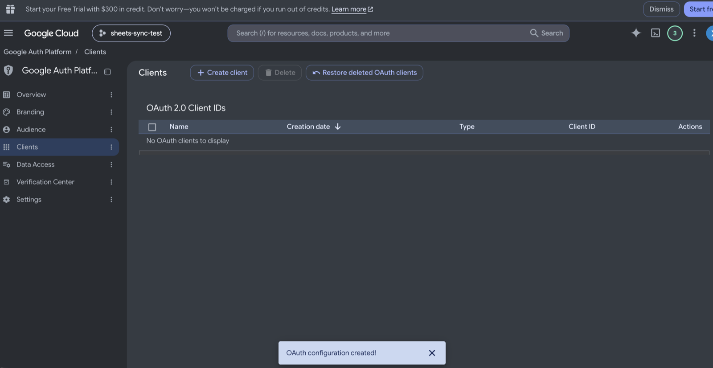

2. Choose application type **Web application** and give it a name.

   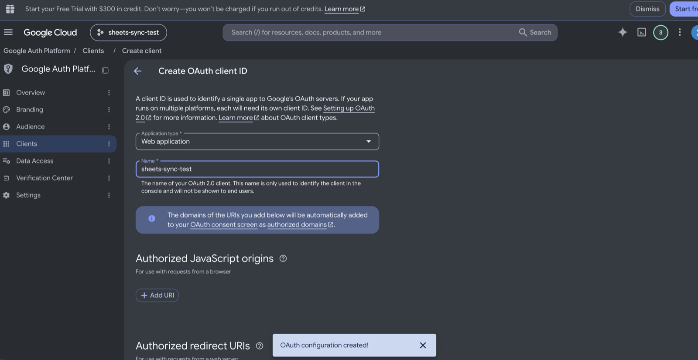

3. Under **Authorized redirect URIs**, click **Add URI** and paste the redirect URI shown in **Settings → Google connection**. It is your app URL followed by `/google/callback`:
   - Docker: `http://localhost:8000/google/callback`
   - `setup.sh`: printed at the end, e.g. `http://203.0.113.10/google/callback`

   It must match exactly (scheme, host, port, path). Then click **Create**. Changes can take a few minutes to apply.

   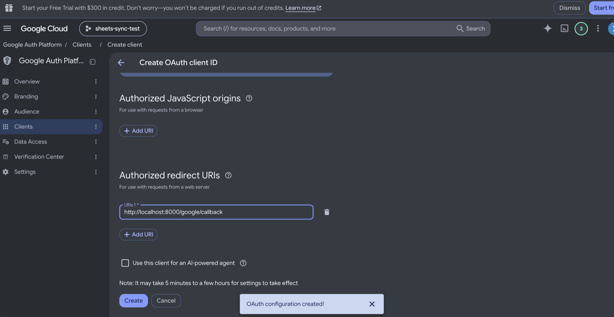

4. Google shows the new client: either copy the **Client ID** and **Client secret**, or click **Download JSON**. You'll paste them into the app in the next step. Keep the secret private: don't commit it, email it or paste it into chats. If it leaks, open the client, click **Add secret**, and delete the old one.

### A3. Connect

1. In the admin panel: **Settings → Google connection → Set OAuth client**. Paste the downloaded JSON (the client ID and secret are filled in for you, and the app warns if the redirect URI isn't registered on the client), or paste the client ID and secret yourself. Confirm with your password.
2. Click **Connect Google account**, choose a test user, and click **Allow**. You're sent back to the settings page with the status **Connected**.

From the terminal instead: `php artisan google:configure --client-json=/path/to/client.json`, then connect in the panel. The consent step needs a browser.

### A4. Testing mode and token expiry

While the consent screen's publishing status is **Testing**, Google lets refresh tokens for test users expire after about **7 days**. When that happens:
- the connection shows **Expired**;
- an alert and a notification ask you to **Reconnect Google account** (one click);
- until then, the API key fallback (if set) keeps public sheets syncing, and private sheets pause.

For long-term use, publish the app (Google may require verification for the Drive scope), or use the API key with public sheets.

## Option B: API key

1. Go to **APIs & Services → Credentials → Create credentials → API key**.
2. Click **Edit API key**. Under **API restrictions**, choose **Restrict key** and select **Google Sheets API**. Save.
3. In the admin panel: **Settings → Google connection → Set API key** (confirm with your password), then click **Test key**.
4. Make each sheet readable by the key: in Google Sheets, **Share → General access → Anyone with the link → Viewer**.

From the terminal: `php artisan google:configure --skip-oauth` (the input is hidden).

---

## Troubleshooting

| Message | Cause and fix |
|---|---|
| `redirect_uri_mismatch` on Google's page | The redirect URI isn't registered, or doesn't match exactly. Copy it from Settings → Google connection into the OAuth client (A2.3). |
| `access_denied` / "app has not completed verification" | The account isn't a test user. Add it under Audience → Test users (A1.5). |
| "Google did not return a refresh token" | Google only sends one with a fresh consent. Remove the app at <https://myaccount.google.com/permissions> and connect again. |
| "The sheet is not public…" | The API key can only read sheets shared as "Anyone with the link can view". Share it that way, or connect OAuth. |
| "The API key was rejected" / "not allowed to use the Google Sheets API" | The key is wrong, deleted, or restricted to another API. Check B2. |
| "not accessible with this Google account" | The connected account can't open the file. Share it with that account, or reconnect with the right one. |
| Connection **Expired** after about a week | Testing-mode token expiry (A4). Click Reconnect. |
| "Credentials can't be read, re-enter them" | `APP_KEY` changed since the values were saved (e.g. a new server or a restored backup). Enter them again. Back up `APP_KEY` together with the database. |
| "Google rate limit reached" | Too many requests per minute. The client retries with growing delays, and the next sync tries again. |
